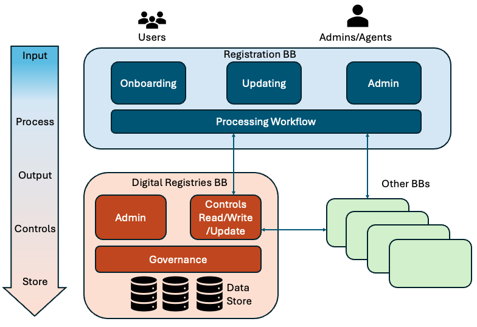

# Overview

## Purpose

The Digital Registries Building Block exists so that governments and the systems they authorise can create and manage trusted, authoritative, uniquely identifiable records about entities such as persons, organisations, places, assets, and events.

It provides **Registry Administration**, **Record Management**, **Governed Access**, **Accountability**, **Data Exchange**, and **Analytics** capabilities.
Together, these capabilities let institutions maintain registry structures and data, control their use, retain an audit trail, exchange records through consistent interfaces, and inspect registry activity.

A common specification matters because government institutions, GovStack Building Blocks, and external systems otherwise have to negotiate different registry interfaces and behaviours for each implementation.
The common contract supports integration and reuse across domains while leaving implementations free to choose their internal database technology and deployment model.

### Place in larger systems

The Digital Registries Building Block is an optional component in the GovStack ecosystem.
Other Building Blocks may use a traditional database platform alone or in combination with it.
It can operate as a standalone service, as one centralised instance containing multiple registries for a domain, or as multiple instances with separate databases.

The upstream specification describes these common relationships:

- the **Registration Building Block** provides an interface through which applicants and government operators manage the lifecycle of claims;
- the **Foundational ID Building Block** uniquely identifies entities;
- the **Workflow Building Block** orchestrates business processes tied to registry data; and
- the **Information Mediator** and **Consent and Authorisation** components support secure, policy-driven exchange between organisations.

## Description

### System under test

The system under test is a generic, domain-agnostic software component that maintains registry structures and records and exposes them through a web user interface and service APIs.
It may logically assemble a record from multiple underlying databases and records changes to registry data and structures in auditable logs.

The component boundary includes registry administration, record processing, access control, audit functions, generated registry APIs, and registry statistics.
Sector-specific applicant interfaces, registration-request workflows, identity services, business-process orchestration, and cross-organisation mediation remain outside that boundary, even when a deployment composes them closely with the Building Block.

The specification observes a solution through its user-facing and service interfaces and through evidence for controls, such as audit-log integrity, that cannot be established from an individual API response alone.

The upstream functional-component view shows a user interface (schema viewer, data viewer and editor, database views, statistics and audit-trail logs), an API interface, administration tools (schema, view, API and authorisation managers), data storage, data import and export, and a security layer.
Queries and schema operations from other Building Blocks and developers reach the API interface through an Information Mediator gateway.
The source adds that applicants mostly reach registry data through client applications such as the Registration Building Block, and that any Building Block can query the registry through its APIs when authorised.
The diagram is informative; it does not prescribe the internal components of an implementation.

 (1).png>)

### Functionalities

The active specification organises the 37 numbered upstream functional-requirement blocks and the required source-only obligations into these functionalities.
The descriptions, capability identifiers, and conformance classification match the front matter of the linked requirement files.

| Functionality | Realises | Conformance | Description | Requirements |
|---|---|---|---|---|
| Access Control | `governed-access` | Core | Registry operators govern who can administer registries and access registry data. | [`requirements/access-control.md`](../requirements/access-control.md) |
| Apply Registry Assurance | `governed-access`, `accountability` | Core | Institutions retain the two explicitly elevated upstream cross-functional data protections. | [`requirements/registry-assurance.md`](../requirements/registry-assurance.md) |
| Audit and Personal Data Protection | `accountability`, `governed-access` | Core | Registry operators and data owners inspect accountable use of registry data, while sensitive data is protected. | [`requirements/audit-and-personal-data.md`](../requirements/audit-and-personal-data.md) |
| Configure API Services | `registry-administration`, `governed-access` | Core | Authorised users and API clients configure and discover the services exposed for each registry database. | [`requirements/configure-api-services.md`](../requirements/configure-api-services.md) |
| Automated Data Exchange | `data-exchange` | Core | Registry operators configure conditional exchanges between registries and external systems. | [`requirements/data-exchange.md`](../requirements/data-exchange.md) |
| Manage Registries | `registry-administration` | Core | Authorised users and API clients create, relate, inspect, publish, version, and remove registry schemas. | [`requirements/manage-registries.md`](../requirements/manage-registries.md) |
| Operate Registry Services | `registry-administration`, `record-management`, `governed-access`, `accountability`, `data-exchange`, `analytics` | Core | Operators and clients use the additional platform, API and workflow behaviours explicitly described outside the DRS list. | [`requirements/operate-registry-services.md`](../requirements/operate-registry-services.md) |
| Owner Identifiers | `accountability`, `governed-access` | Core | Registry operators may identify fields that link personal data to its owner. | [`requirements/owner-identifiers.md`](../requirements/owner-identifiers.md) |
| Personal Data Field Tagging | `accountability`, `governed-access` | Core | Registry operators may identify fields that contain personal data. | [`requirements/personal-data-field-tagging.md`](../requirements/personal-data-field-tagging.md) |
| Record Access | `record-management`, `governed-access` | Core | Client systems process authorised registry records through OpenAPI services. | [`requirements/record-access.md`](../requirements/record-access.md) |
| Record Views and Operator Data Handling | `record-management`, `governed-access`, `accountability` | Core | Registry operators view, search, edit, import, export and share registry records. | [`requirements/record-views.md`](../requirements/record-views.md) |
| Represent Registry Data | `registry-administration`, `record-management`, `accountability` | Core | Registry implementers retain the minimum data fields and resource relationships specified by the upstream model. | [`requirements/represent-registry-data.md`](../requirements/represent-registry-data.md) |
| Statistical Reporting | `analytics` | Core | Registry operators inspect standard and field-configurable analyses of registry data. | [`requirements/statistical-reporting.md`](../requirements/statistical-reporting.md) |
| Transfer Registry Schemas | `registry-administration` | Core | Authorised users exchange registry schemas as JSON, YAML, or XLS files. | [`requirements/transfer-schemas.md`](../requirements/transfer-schemas.md) |
| Database Views | `record-management`, `governed-access` | Database Views extension | Registry operators define read-only selections of registry data for governed reuse. | [`requirements/records-optional-database-views.md`](../requirements/records-optional-database-views.md) |
| Use Registry Schema Templates | `registry-administration` | Schema Templates extension | Authorised users create registries from reusable, versioned templates and exchange those templates. | [`requirements/schema-templates.md`](../requirements/schema-templates.md) |
| Service Usage Statistics | `analytics`, `accountability` | Service Usage Statistics extension | Registry operators retain usage records for API services and searches. | [`requirements/service-usage-statistics.md`](../requirements/service-usage-statistics.md) |
| Statistical Queries API | `analytics`, `governed-access` | Statistical Queries API extension | Authorised clients query registration and programme data for statistical use. | [`requirements/statistics-api.md`](../requirements/statistics-api.md) |

These functionalities preserve the source division between registry administration, data management, interoperability, and monitoring and analytics, while giving each group one active requirement file.
Applicants do not access the Building Block directly in the upstream model.
They use sectoral applications or other GovStack Building Blocks to invoke the Record Access and, when claimed, Statistical Queries API functionalities.

#### Core and extensions

The core combines registry administration, governed record access, registry-data representation, accountability and assurance, data exchange, operation of the source-only service behaviours, and basic statistical reporting.
A solution that meets only the core can create and administer registries, represent and process authorised records, inspect and protect accountable data use, exchange data, operate the required service behaviours, and produce registry reports.

The source does not draw this boundary cleanly.
Some required clauses depend on behaviour that another clause marks optional: DRS-5 requires custom read API services built from views, which DRS-9 makes optional; DRS-8, DRS-35 and DRS-37 require logs and reports keyed to personal-data and owner-identifier fields, whose tagging DRS-13 and DRS-14 make optional; and chapter 4 requires registry usage statistics that overlap the optional usage statistics of DRS-12.
Between extensions, the full registry template of DRS-20 includes the views that only the Database Views extension defines.
The migration keeps each clause at its source level, does not make one extension depend on another, and records these overlaps in the [source findings](../resources/source-findings.md#cross-clause-ambiguities) for substantive review.

The source marks the requirements grouped into the following extensions as optional.
The migration gives each optional group a name so that a solution can make an explicit additional conformance claim.

| Extension | Adds | Functionalities | Requires |
|---|---|---|---|
| Database Views | Governed, read-only selections of registry data. | Database Views | Core |
| Schema Templates | Reusable, versioned registry templates and template exchange. | Use Registry Schema Templates | Core |
| Service Usage Statistics | Retention of API-service and registry-search usage information. | Service Usage Statistics | Core |
| Statistical Queries API | Authorised statistical queries through an API. | Statistical Queries API | Core |

### Actors

| Actor | Kind | Boundary | Interaction with the Building Block |
|---|---|---|---|
| Administrator/Analyst | Person | Outside | Designs, configures, modifies, and administers registries, schemas, rules, policies, access, and APIs through the administrative interfaces. |
| Developer | Person or client-system operator | Outside | Creates and manages registry structures and services through APIs. |
| Applicant | Person, organisation, or system | Outside | Uses a sectoral application or another Building Block, which invokes authorised registry services on the applicant's behalf. |
| Operator | Person | Outside | Reviews and processes an applicant's submission through the Registration or another client system. |
| Registrar | Organisation or authority | Outside | Authorises the receipt, validation, and recording of claims. |
| Data owner | Person | Outside | May inspect the recorded use of personal data associated with the person's identifier. |
| Registration Building Block or sectoral application | System | Outside | Captures requests and invokes registry services. |
| Foundational ID Building Block | System | Outside | Supports unique identification of entities. |
| Workflow Building Block | System | Outside | Orchestrates processes that use registry data. |
| Information Mediator and Consent and Authorisation components | System | Outside | Mediate policy-driven exchange between organisations. |

### Interfaces

| Interface | Counterpart | Direction | Type | Contract location |
|---|---|---|---|---|
| Registry user interface | Administrator/Analyst and data owner | Inbound actions and outbound views | User interface | The linked Core and extension functionality files, with their source workflows in [Internal Workflows](../resources/workflows.md) |
| Registry Data API | Authorised client systems | Inbound requests and outbound responses | Service API | [GovStack Digital Registries Data API template 1.3.0](../assets/GovStack_Digital_registries_BB_Data_API_template-1.3.0.json), projected in [`resources/api.yml`](../resources/api.yml) |
| Registry Database API | Developers and administrative clients | Inbound requests and outbound responses | Service API | [GovStack Digital Registries Database API template 1.3.0](../assets/GovStack_Digital_registries_BB_Database_API_template-1.3.0.yaml), projected in [`resources/api.yml`](../resources/api.yml) |
| Additional reporting and extension APIs | Authorised client systems | Inbound requests and outbound responses | Service API | [Database Views](../requirements/records-optional-database-views.md), [Statistical Reporting](../requirements/statistical-reporting.md), and [Statistical Queries API](../requirements/statistics-api.md); [`requirement-migration.yml`](../resources/requirement-migration.yml) records where the upstream source publishes no exact operation binding |
| OpenAPI descriptions | Developers and client systems | Outbound | File | [Configure API Services](../requirements/configure-api-services.md), [Operate Registry Services](../requirements/operate-registry-services.md), and [`resources/api.yml`](../resources/api.yml) |
| Registry data, schema, and template files | Administrator/Analyst and external tools | Inbound and outbound | File | [Record Views and Operator Data Handling](../requirements/record-views.md), [Transfer Registry Schemas](../requirements/transfer-schemas.md), and the [Schema Templates extension](../requirements/schema-templates.md) |
| External registry lookup and exchange | External registry databases | Outbound requests and inbound responses | Consumed API | [Automated Data Exchange](../requirements/data-exchange.md) and [Owner Identifiers](../requirements/owner-identifiers.md) |
| Information Mediator exchange | Information Mediator and external systems | Inbound and outbound | Protocol and mediated APIs | [Audit and Personal Data Protection](../requirements/audit-and-personal-data.md) and [Operate Registry Services](../requirements/operate-registry-services.md) define the Digital Registries side; the counterpart contract is outside this specification |
| Registry events and subscriptions | Authorised downstream consumers | Outbound events and inbound subscription control | Event | [Operate Registry Services](../requirements/operate-registry-services.md) |
| External integrity log | External blockchain service | Outbound | Consumed API | The recommended external-integrity option in [Audit and Personal Data Protection](../requirements/audit-and-personal-data.md) |

The [Service APIs resource](../resources/service-apis.md) retains the upstream method-and-path index for the two API source contracts.
