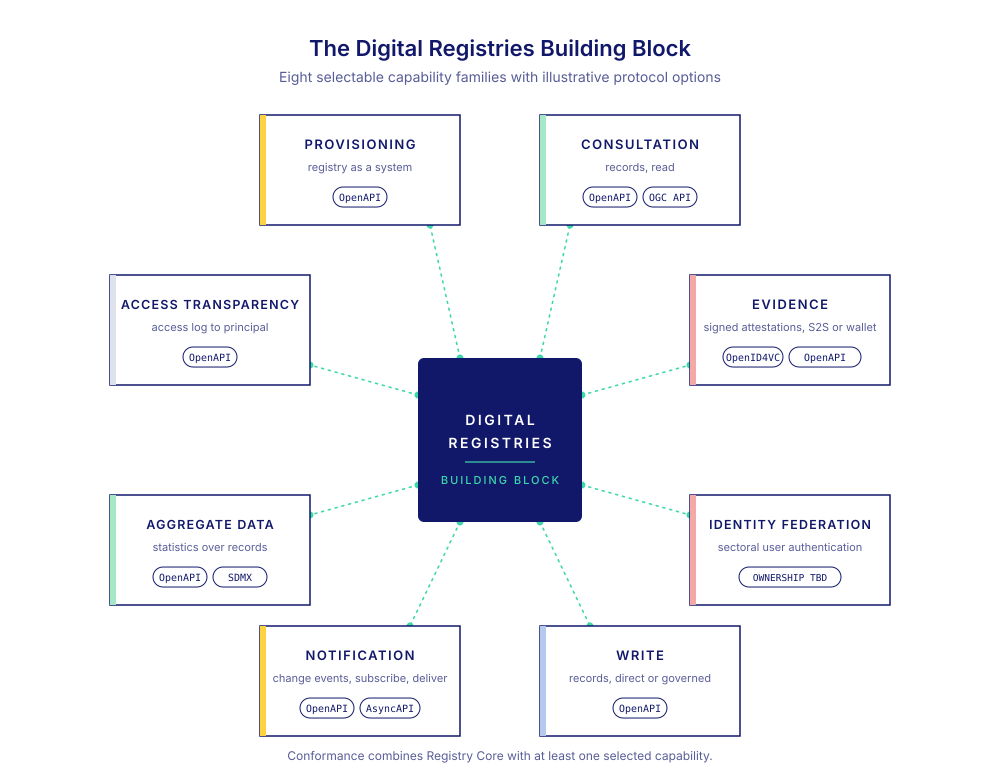

# API Family Catalogue

The Digital Registries Building Block groups its externally visible capabilities into eight families. A family describes an adopter outcome and a coherent trust boundary. It does not prescribe an internal module, product architecture, or transport.

The [draft conformance model](conformance.md#draft-conformance-model) defines two core functionalities. Its `registry-service` variation point requires at least one of the six Consultation operation options. The API-family catalogue remains useful binding vocabulary, but family labels are not framework capabilities or functionality claims.

<figure><figcaption>Registry Core provides the shared foundation. Consultation supplies the six operation options in this draft; the other families remain roadmap material.</figcaption></figure>

## Reading the catalogue

Normative statements are placed in the functionality files [Discover Registry Services](../requirements/registry-discovery.md) and [Provide Registry Services](../requirements/registry-services.md). The [Registry Core model](registry-core-model.md) and [Consultation binding](consultation-binding.md) retain the supporting concepts, workflows, data structures, and protocol binding.

[Requirement maturity](conformance.md#requirement-maturity) defines requirement classification and current status. Informative family descriptions do not create requirements.

## Registry Core

Registry Core provides the identity, metadata, discovery, stable Record references, schema context, and field meanings shared by every API family. It also defines how supplied revision, lifecycle, and provenance metadata are described. It is not itself an API family. The two core functionalities use the [Registry Core model](registry-core-model.md), and requirements concerning returned Records apply to selected operations that return Records.

Registry Core requires publication of machine-readable Registry and service metadata. Service descriptions identify exposed API families, endpoints, and operational contracts. This publication can use static metadata and does not require a Provisioning API. Paths, methods, parameters, schemas, and security details belong in the linked operational contract, such as OpenAPI.

## Family catalogue

Consultation is the only family with requirements and a contract in this release.

| Family | Adopter outcome | Capabilities | Status in this release |
|---|---|---|---|
| [Consultation](consultation-binding.md) | Obtain a permitted representation of Registry information. | Retrieve, Lookup, List, Search, Revision List, Revision Retrieve | DRAFT requirements and a draft HTTP contract, including selectable temporal, caller-discovery, and purpose-bound behaviour. Existence Check, Record Match, and GIS Query are outside this baseline. |

The remaining families are informative roadmap descriptions. They have no requirements, contracts, or tests in this release.

| Family | Adopter outcome | Capabilities |
|---|---|---|
| [Provisioning](roadmap/provisioning.md) | Configure a Registry service and publish its externally visible contracts. | Metadata administration, schemas, capability publication, bulk transfer |
| [Evidence](roadmap/evidence.md) | Obtain a signed assertion derived from authoritative Registry information. | Direct attestation, wallet-mediated credential, status |
| [Write](roadmap/write.md) | Create a Record or accept a new authoritative revision. | Direct write, governed write, correction |
| [Notification](roadmap/notification.md) | Inform authorised subscribers that Registry state changed. | Subscribe, filter, deliver, retry, replay |
| [Aggregate Data](roadmap/aggregate-data.md) | Obtain approved statistics derived from Registry Records. | Aggregate query, dataset metadata, published release |
| [Access Transparency](roadmap/access-transparency.md) | Obtain a permitted view of access to a related Record. | Access-history consultation |
| [Identity Federation](roadmap/identity-federation.md) | Authenticate a person represented by a sectoral Registry Record to a Relying Service and release authorised claims. | Profile ownership and binding to be decided with the Identity team; cross-BB ownership unresolved |

## Selecting future families

An adopter selects capabilities from the Registry's institutional responsibilities, domain model, and consumer needs, not from the feature list of a particular product. Useful questions include:

- Do consumers know Record Identifiers, need exact lookup by a domain identifier, or need collection browsing or search?
- Does the Registry expose historical revisions, mutation, events, evidence, statistics, or subject authentication?
- Which actors can invoke each capability, and what may each actor learn?
- Does the Registry own an approval process, or accept an approved result from another service?
- Does the consumer need live Registry information, a portable proof, or notification that state changed?
- Which sector semantic model and protocol binding fit the participating systems?

Each family page states its boundary and maturity. A Registry or sector profile supplies domain-specific schemas, field meanings, declared selectors and search criteria, and other constraints needed by its selected services. It defines lifecycle and revision semantics when those are provided or required. No roadmap family can be claimed under this alpha.
